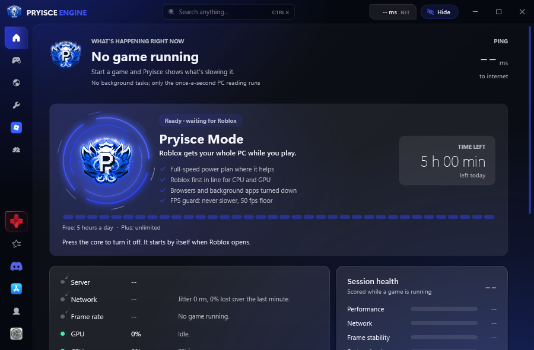
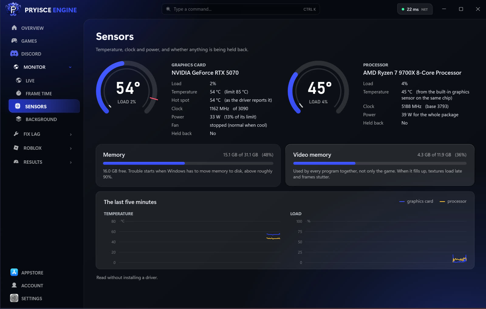
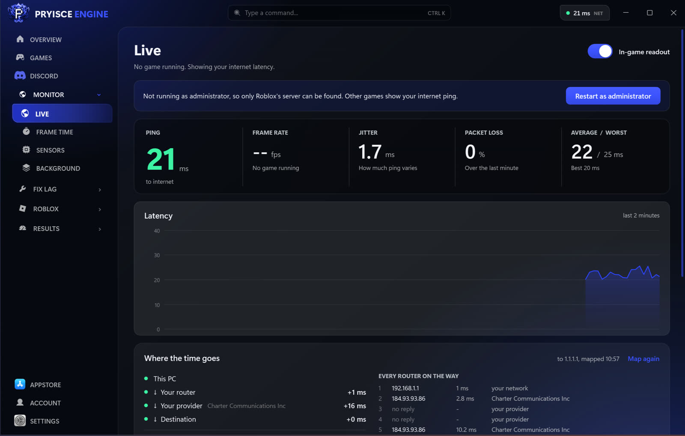
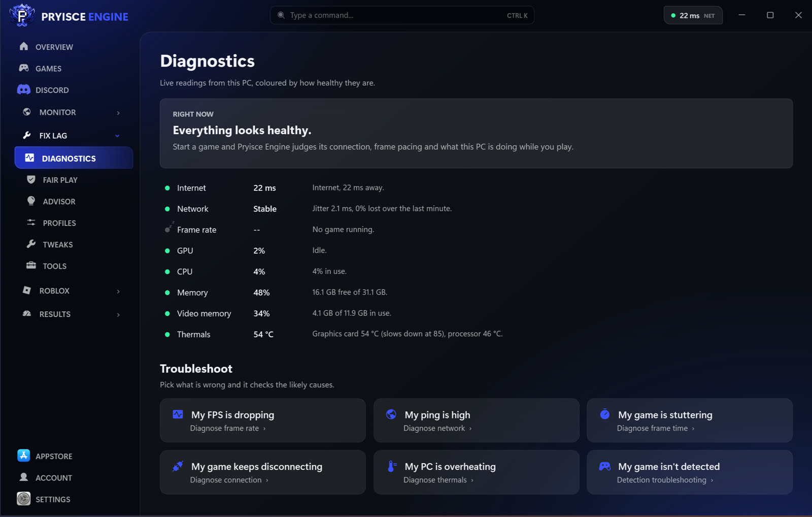
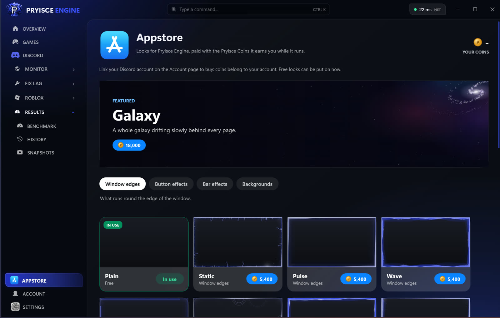
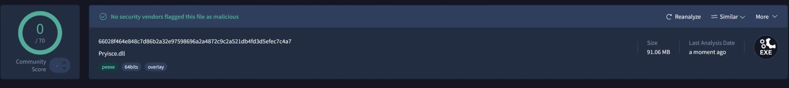

# Pryisce Engine

The PC part of Pryisce: a free Windows app that tunes your PC for games, Roblox first. 
It measures your ping, fps and temperatures, shows where lag comes from, and has the tweaks and tools to fix it. 
**One file:** download `Pryisce.exe` and run it. Nothing to unzip, nothing to install. 
Looking for the BedWars tools? They are in **Pryisce BedWars**, which you get from the [Pryisce app](https://github.com/pryisce/pryisce-downloads).

**[Download](https://github.com/pryisce/pryisce-engine/releases/latest)** &nbsp;·&nbsp; **[Patch notes](https://github.com/pryisce/pryisce-engine/releases)** &nbsp;·&nbsp; **[Install](#install)** &nbsp;·&nbsp; **[Is it safe?](#is-it-safe)**

## What is in it

| | |
|---|---|
| **Measure** | Live ping, Frame Time, Sensors, Background programs |
| **Find lag** | Diagnostics |
| **Fix it** | Advisor, Profiles, Tweaks, Mods, Frame Generation, Tools |
| **Check it worked** | Benchmark, History, Snapshots |
| **Roblox** | Pryisce Mode, Mods, Server globe, Discord card |
| **Make it yours** | Appstore looks, Account, Pryisce Coins |

## Measure

<table>
<tr>
<td width="50%"></td>
<td width="50%"></td>
</tr>
</table>

- **Live**: ping to the game server you are on, five times a second, and which part of the route the delay is on
- **Frame Time**: fps ten times a second, with the lows and every freeze
- **Sensors**: temperature and load dials for the graphics card and processor, plus clock, power and fan. No driver needed
- **Background**: which programs are using your PC while you play, with a button to pause them

## Find lag

- **Diagnostics**: six troubleshooters (fps dropping, high ping, stutter, disconnects, overheating, game not detected) that check the usual causes one by one

## Fix it

- **Profiles**: type how you play, like "Roblox, lowest delay, pause Chrome", and the app builds the profile and shows what it understood before you keep it. You can also build one switch by switch. Make as many as you want. A profile starts with the game and everything it changed is undone when the game closes
- **Advisor**: scans your PC and suggests only the tweaks that fit it, with how much each one helps and what the risk is
- **Tweaks**: eighty Windows and network tweaks, each one explained, each one can be undone
- **Mods**: set how Roblox looks, from blurriest-and-fastest to sharpest, with a real before-and-after picture for every step
- **Frame Generation**: extra frames for Roblox
- **Tools**: one-off jobs like clearing caches

## Check it worked

- **Benchmark**: timed runs before and after a change, next to each other
- **History**: every session is saved and can be played back
- **Snapshots**: your settings are saved before each change, so you can go back

## Roblox

- **Pryisce Mode**: while Roblox runs, it gets your whole PC: full-speed power plan, Roblox first in line for the processor and graphics card, browsers and background apps turned down
- **Server globe**: when you join or teleport, a 3D globe shows which data centre you are connecting to. It lasts 6.4 seconds at most and closes by itself
- **Discord**: shows Pryisce Engine on your Discord profile with your own text and picture

## Make it yours

- **Appstore**: window edges, button and bar effects and page backgrounds are looks you put on. The free ones go on at once; the rest cost Pryisce Coins, with 60 to collect. Each one plays in front of you before you pick it, and what you put on is yours for good
- **Account**: link your Roblox name to see your avatar, your coins and the looks you own. Pryisce Coins add up for every minute Pryisce Engine runs while your Discord is linked

## Settings

- **Look**: 24 colour palettes (royal blue by default), plus the Appstore looks. Switches, sliders and meters follow the colour you pick. The window is a small panel with a slim side bar of icons; hover an icon to see its name
- **Notifications**: a small notice in the corner for the things you choose: heat warnings, a profile starting, a finished benchmark, ping spikes, frame freezes, a new server. Each one has its own switch. Notices cannot be clicked, so they never get in the way of a game
- **In-game overlay, hotkeys and sounds**
- **A walk-through tutorial** of every page, with a colour picker, progress dots and arrow keys
- **Updates**: close the app and open it again to get the newest version

## Part of Pryisce

Pryisce Engine was the first Pryisce app. It is now the PC and Roblox tweaks part only, and stays here on its own page.
Everything else is its own app, gotten and updated from **[Pryisce](https://github.com/pryisce/pryisce-downloads)**:

| App | What it is for |
|---|---|
| **Pryisce** | The store: gets, updates and opens every Pryisce app |
| **Pryisce BedWars** | Auto clicker and tuner, Smart AutoKey, Auto Kit, Hit Fix, crosshair, mods, skies, shaders, win tracker |
| **Pryisce PC Utility** | Windows tweaks, cleanup, startup apps, network tools, sensors, benchmarks and snapshots |

## Install

1. Download `Pryisce.exe` from the [latest release](https://github.com/pryisce/pryisce-engine/releases/latest).
2. Run it. One file, nothing to unzip or install.

Copies you already have update themselves the next time they start. Needs Windows 10 or 11 (64-bit). Nothing else to install — the runtime is packed inside the file.

## Is it safe?

Scan reports you can open yourself:

| Scanner | Result | What was scanned | |
|---|---|---|---|
| **VirusTotal** | **0 of 70** security vendors flagged it | `Pryisce.exe`, the current build | [**Open the report**](https://www.virustotal.com/gui/file/66028f464e848c7d86b2a32e97598696a2a4872c9c2a521db4fd3d5efec7c4a7) |
| **Triage sandbox** | **1 / 10**, where 10 is known malware | `Pryisce.exe`, an earlier version | [**Open the report**](https://tria.ge/261012-xwztdszscy) |

Scanned 18 October 2026. Each report is for the version it names; every release is a new file.

To check your own download, search this SHA-256 on [virustotal.com](https://www.virustotal.com/gui/home/search) or upload the file there.

<!-- scan:start -->
| | |
|---|---|
| Latest release | `PryisceEngine-1.5.5.zip` |
| SHA-256 | `6184648BEFCFEE6F3DDE87CFBADBF47ABDBA3510D34C354375A9CF5124FBBE05` |
<!-- scan:end -->

What the app does and does not do:

- No telemetry. You do not need an account to use it.
- Linking your Discord account is optional. If you link it, the app talks to the Pryisce server to keep your coins and the looks you own.
- Nothing is injected into a game and no game memory is read.
- Mods change Roblox's own settings files, keep the originals, and can be put back with one click.
- Every tweak is saved in a snapshot first and can be undone.
- Updates are signed, so a copy only accepts updates from the publisher.
- It goes online to check GitHub for updates, to look up where a game server is, and to read public Roblox info (names and pictures).

> [!WARNING]
> Changed game files can be against a game's rules. Using Mods online is at your own risk. The ping, fps, diagnostics and tweak features do not touch the game.

---

Pryisce Engine is not affiliated with Roblox Corporation or any game publisher.

