

# Pryisce Engine

A free Windows app for PC gamers, made mostly for Roblox. 
It measures your ping, fps and temperatures, shows where lag comes from, and has the tweaks and tools to fix it.

**[Download](https://github.com/pryisce/pryisce-engine/releases/latest)** &nbsp;·&nbsp; **[Patch notes](https://github.com/pryisce/pryisce-engine/releases)** &nbsp;·&nbsp; **[Install](#install)** &nbsp;·&nbsp; **[Is it safe?](#is-it-safe)**

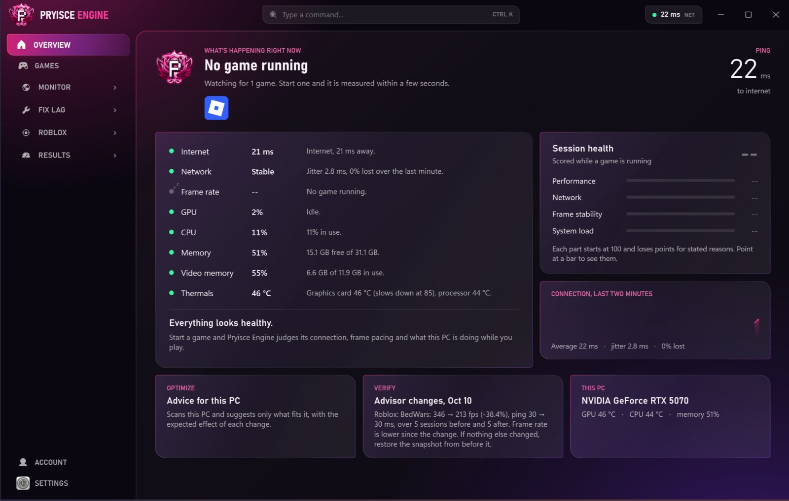

## What is in it

| | |
|---|---|
| **Measure** | Live ping, Frame Time, Sensors, Background programs |
| **Find lag** | Diagnostics, Fair Play |
| **Fix it** | Advisor, Profiles, Tweaks, Frame Generation, Tools |
| **Check it worked** | Benchmark, History, Snapshots |
| **Roblox** | Server globe, Auto Clicker, BedWars, Crosshair, Discord card |

## Measure

<table>
<tr>
<td width="50%">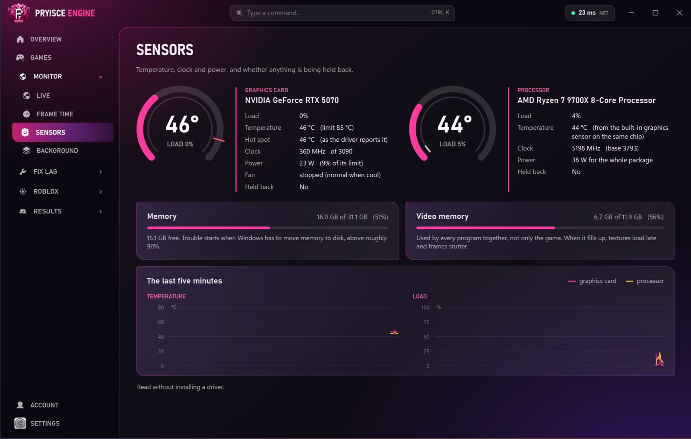</td>
<td width="50%">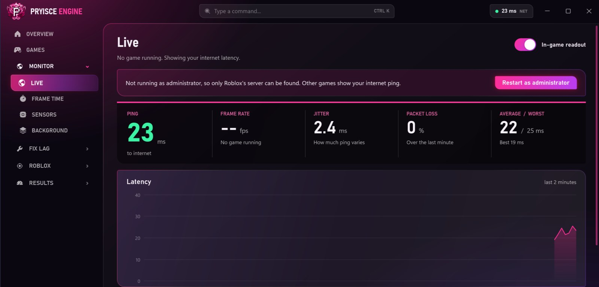</td>
</tr>
</table>

- **Live**: ping to the game server you are on, five times a second, and which part of the route the delay is on
- **Frame Time**: fps ten times a second, with the lows and every freeze
- **Sensors**: temperature and load dials for the graphics card and processor, plus clock, power and fan. No driver needed
- **Background**: which programs are using your PC while you play, with a button to pause them

## Find lag

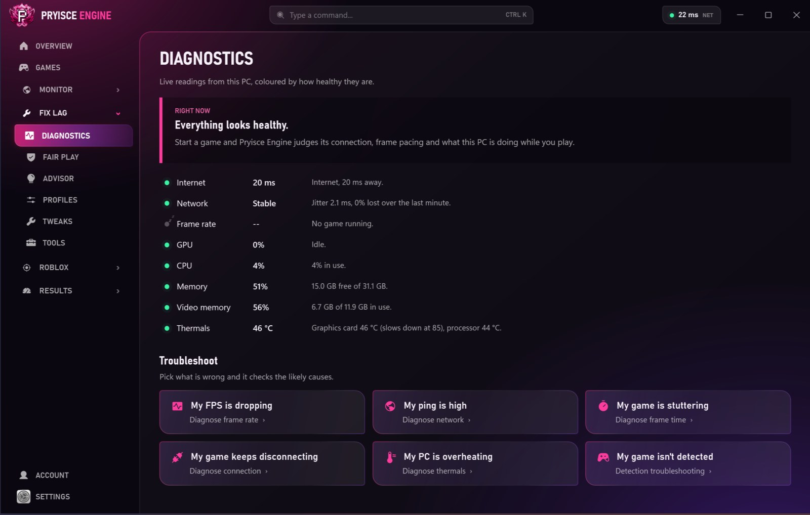

- **Diagnostics**: six troubleshooters (fps dropping, high ping, stutter, disconnects, overheating, game not detected) that check the usual causes one by one
- **Fair Play**: tells you if a ping spike came from your router, your internet provider or the game server

## Fix it

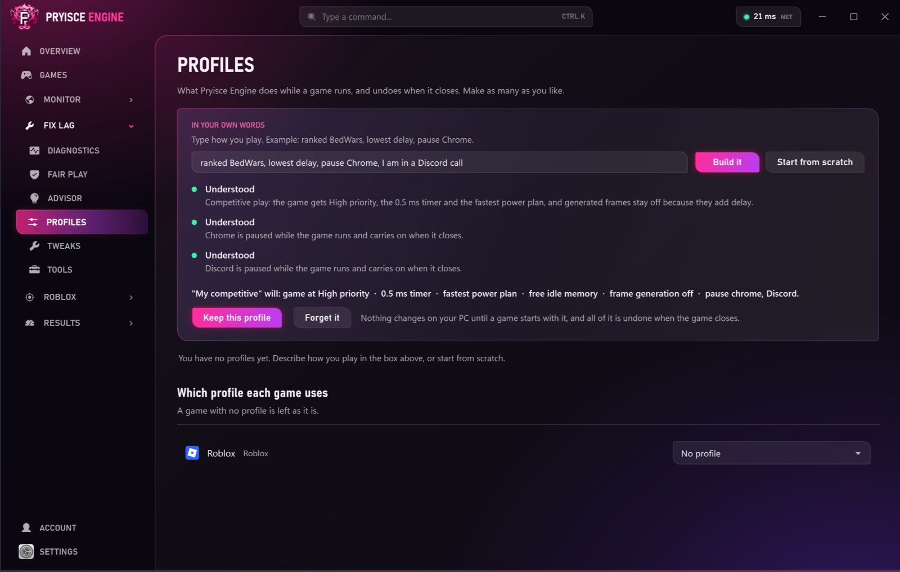

- **Profiles**: type how you play, like "ranked BedWars, lowest delay, pause Chrome", and the app builds the profile and shows what it understood before you keep it. You can also build one switch by switch. Make as many as you want. A profile starts with the game and everything it changed is undone when the game closes
- **Advisor**: scans your PC and suggests only the tweaks that fit it, with how much each one helps and what the risk is
- **Tweaks**: eighty Windows and network tweaks, each one explained, each one can be undone
- **Frame Generation**: extra frames for Roblox
- **Tools**: one-off jobs like clearing caches

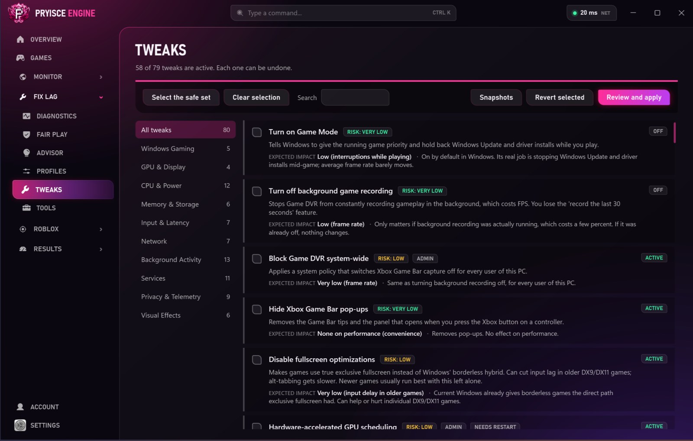

## Check it worked

<table>
<tr>
<td width="50%">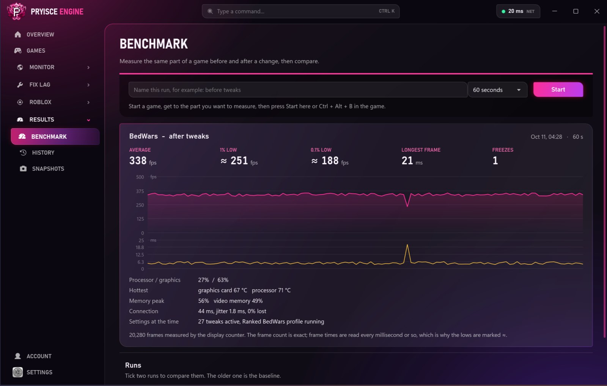</td>
<td width="50%">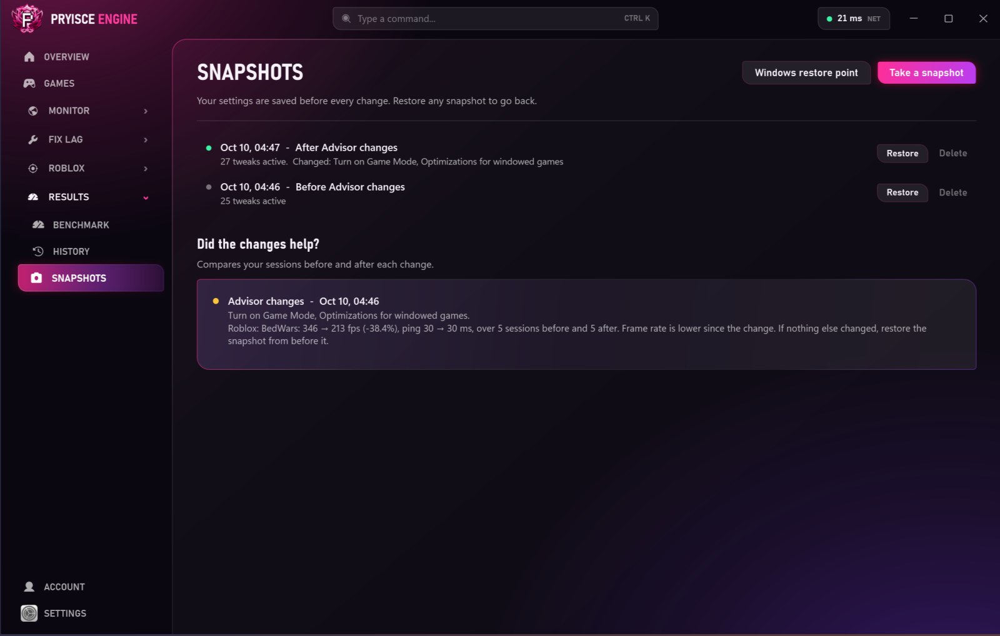</td>
</tr>
</table>

- **Benchmark**: timed runs before and after a change, next to each other
- **History**: every session is saved and can be played back
- **Snapshots**: your settings are saved before each change, so you can go back

## Roblox

- **Server globe**: when you join or teleport, a 3D globe shows which data centre you are connecting to, until you have loaded in

<table>
<tr>
<td width="50%">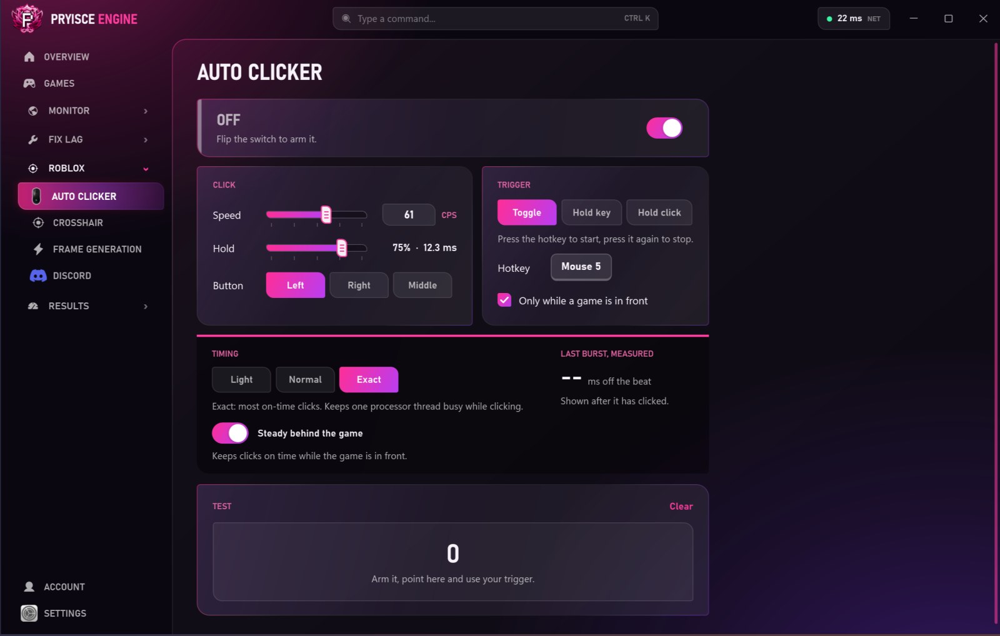</td>
<td width="50%">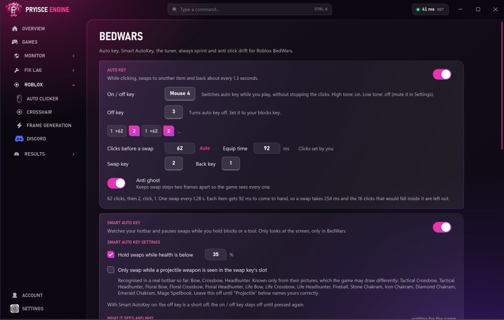</td>
</tr>
<tr>
<td width="50%">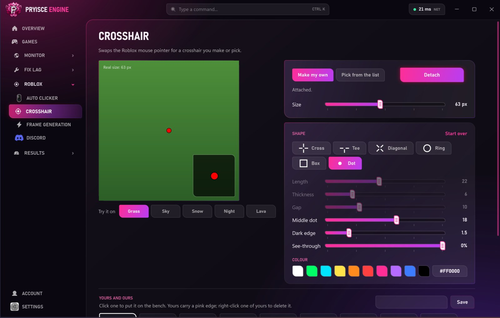</td>
<td width="50%">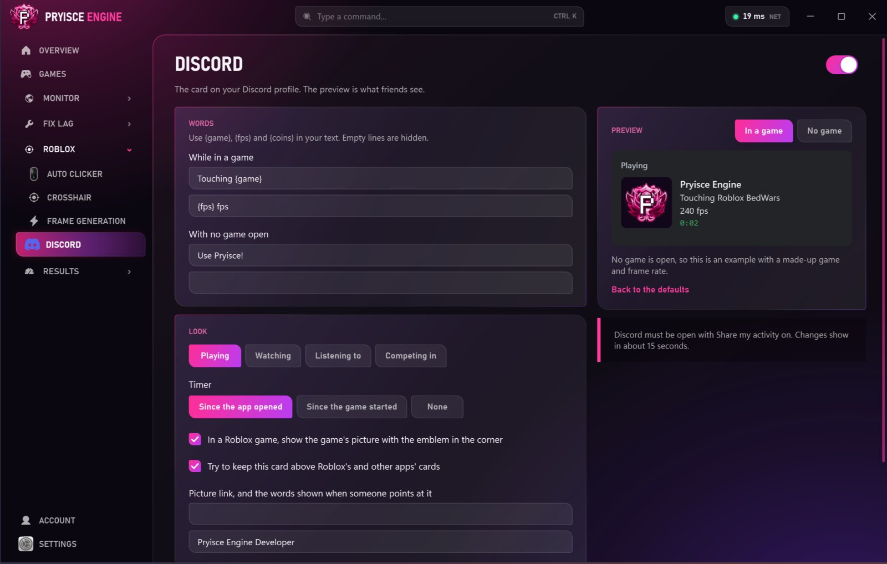</td>
</tr>
</table>

- **Auto Clicker**: no speed cap and evenly timed clicks. Three timing levels (Light, Normal, Exact), an option that stops Windows slowing it down behind the game, and a readout of how far off the beat the last burst was
- **BedWars**: auto key swap with an on/off key and an off key, Smart AutoKey, always sprint and anti stick drift. One press of the tuner finds your best sword speed and then your best swap timing. The tab only shows while you are in BedWars
- **Fight log** (BedWars, off until you switch it on): counts the hits you take from your own health bar, reads who you fought from the name tag and the kill feed, and marks fights where hits came faster than the game allows. Fights on a bad ping are never marked. It only looks at your screen
- **Crosshair**: swaps the Roblox mouse pointer for a crosshair you make or pick, at the size you pick
- **Discord**: shows Pryisce Engine on your Discord profile with your own text and picture

## Settings

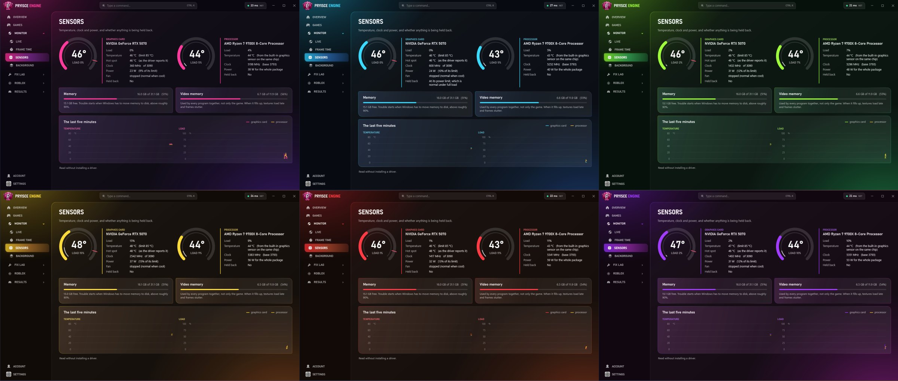

- **Look**: 24 colour palettes. Switches, sliders and meters follow the colour you pick. The side bar shows eight rows; the other pages open from four groups
- **Notifications**: a small notice in the corner for the things you choose: heat warnings, a profile starting, a finished benchmark, ping spikes, frame freezes, a new server. Each one has its own switch. Notices cannot be clicked, so they never get in the way of a game
- **In-game overlay, hotkeys and sounds**
- **Updates**: close the app and open it again to get the newest version

## Install

1. Download `PryisceEngine-x.y.z.zip` from the [latest release](https://github.com/pryisce/pryisce-engine/releases/latest).
2. Unzip it anywhere and run `Pryisce.exe`.

Needs Windows 10 or 11 (64-bit) and the [.NET 10 Desktop Runtime](https://dotnet.microsoft.com/download/dotnet/10.0).

## Is it safe?

Scan reports you can open yourself:

| Scanner | Result | What was scanned | |
|---|---|---|---|
| **VirusTotal** | **0 of 71** security vendors flagged it | `Pryisce.exe`, version 0.0.16 | [**Open the report**](https://www.virustotal.com/gui/file/706a5b2969a77725f8e8f87b6a574f8c3a87f190dbfaf01b5f8b33104276e478) |
| **Triage sandbox** | **3 / 10** (static 3, behaviour 1), where 10 is known malware | `Pryisce.exe`, an earlier version | [**Open the report**](https://tria.ge/261007-ef13ea1zay) |

Scanned 7 October 2026. Each report is for the version it names; every release is a new file.

To check your own download, search this SHA-256 on [virustotal.com](https://www.virustotal.com/gui/home/search) or upload the zip there.

<!-- scan:start -->
| | |
|---|---|
| Latest release | `PryisceEngine-0.0.45.zip` |
| SHA-256 | `FE708CC3ABC98B878E4930E5485E3E6904C0EA7ACD2A33F85B3CA80AC296B079` |
<!-- scan:end -->

What the app does and does not do:

- No telemetry. You do not need an account to use it.
- Linking your Discord account is optional. If you link it, the app talks to the Pryisce server to keep your coins and level.
- Nothing is injected into a game and no game memory is read.
- The auto clicker, auto key, always sprint and anti stick drift send normal keyboard and mouse input.
- Smart AutoKey and the fight log only look at a picture of the BedWars screen, and only while BedWars is the window in front. The fight log asks Roblox's public search for the username behind a display name.
- The crosshair replaces three pointer pictures in the Roblox folder, keeps the originals, and puts them back when you detach it.
- Every tweak is saved in a snapshot first and can be undone.
- Updates are signed, so a copy only accepts updates from the publisher.
- It goes online to check GitHub for updates, to look up where a game server is, and to read public Roblox info (names, pictures, crosshair decals).

> [!WARNING]
> Auto clickers, input helpers and changed game files can be against a game's rules. Using them online is at your own risk and can get an account banned. The ping, fps, diagnostics and tweak features do not touch the game.

---

Pryisce Engine is not affiliated with Roblox Corporation or any game publisher.

